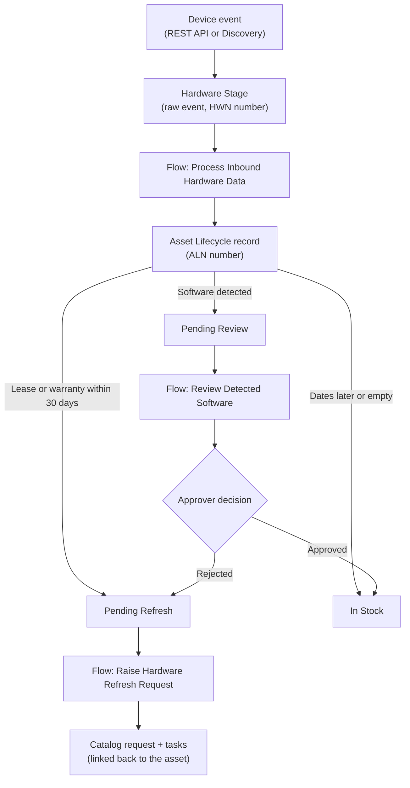

# Automated Asset Lifecycle Engine (AALE)

*Automating IT asset lifecycle decisions so hardware renewals and unapproved software are caught before they become cost or audit problems.*

**Status:** ✅ Core build complete: event ingestion, lifecycle automation, tracking numbers, MID Server + Discovery, and the ITSM layer (catalog requests and approvals). 🎬 Demo video coming soon.

## 🎯 The Business Problem

Organizations track what they own and pay for (ITAM) separately from what is actually running on the network (ITOM), and the work that follows (ITSM) is often manual. When these stay disconnected:

- Hardware runs past its lease or warranty and nobody notices until it fails or costs extra
- Unapproved or unrecorded software goes unreviewed
- Audits turn into manual spreadsheet reconciliation
- Someone has to notice a problem *and* remember to open the right request

## 💡 Business Impact

- **Avoid surprise costs:** assets nearing lease or warranty expiry are flagged early
- **Reduce audit and compliance risk:** unrecorded software is surfaced for human review
- **Save manual effort:** lifecycle states, requests, tasks and approvals are created automatically, with a trackable ID on every event and asset
- **Keep everything traceable:** each asset links to the request raised for it

## 👥 Stakeholders

| Role | What they need |
|---|---|
| IT Asset Manager | A reliable view of every asset's lifecycle state |
| Procurement | Early notice of renewals and refreshes |
| Security / Compliance | Visibility into, and a decision on, unreviewed software |
| Service Desk | Traceable records they can reference by number |

See [USER_STORIES.md](USER_STORIES.md) for the detailed requirements.

## 🔄 The Process



### Business rules

| Condition | Resulting state | What happens next |
|---|---|---|
| Hardware event, lease or warranty expires within 30 days (empty dates ignored) | Pending Refresh | A Hardware Refresh Request is raised automatically, with tasks for the right teams, and linked back to the asset |
| Hardware event, dates not expiring soon or empty | In Stock | None |
| Software-detected event | Pending Review | An approval is requested. **Approved** sets the asset to In Stock. **Rejected** sets it to Pending Refresh, which raises a refresh request |

**Assumptions:** lease and warranty dates come from a procurement or ITAM source (Discovery cannot see them), so they are supplied through the REST API today. The 30-day window is a configurable business rule, not a fixed standard.

## 📏 How Success Would Be Measured

Targets would be agreed with stakeholders. Candidate measures:

- Share of assets with a known lifecycle state
- Number of expiring assets flagged before expiry
- Time from detection to a refresh request or review decision
- Software items reviewed vs. left unreviewed

## ✅ What's Built

| Component | Details |
|---|---|
| Scripted REST API | `POST /api/x_1839598_automa_0/aale_inbound_events/events` validates `hostname` and `event_type`, then writes the event to Hardware Stage. Returns 201 with the new record's sys_id, or 400 on bad input. |
| Hardware Stage table | Staging table for inbound events. Each row gets a Hardware Number (HWN0001001, ...). |
| Asset Lifecycle table | The managed record of each asset and its state. Each row gets an Asset Lifecycle Number (ALN0001001, ...). |
| Auto-numbering | Number Maintenance counters plus a read-only number field on each table, for traceability like Incident numbers. |
| Flow: Process Inbound Hardware Data | Creates an Asset Lifecycle record and sets its state when a Hardware Stage record is created. |
| Business Rule | Defaults Lifecycle State to In Stock if it is ever empty. |
| Service Catalog item: Hardware Refresh Request | Variables for hostname, asset lifecycle number and expiry date. Generates tasks for the right teams. |
| Flow: Raise Hardware Refresh Request | When an asset becomes Pending Refresh, submits the catalog request and writes the request back onto the asset record (Hardware Refresh Request field). Runs once per asset. |
| Flow: Review Detected Software | When an asset becomes Pending Review, asks for approval. Approved sets In Stock. Rejected sets Pending Refresh. The decision is recorded in the Approval field. |
| MID Server + Discovery | MID Server validated; Discovery scanned a Windows host into the CMDB (hardware, OS, installed software). |
| Seed script | `seed/seed_hardware_stage.js` creates sample events for testing and demos (safe to re-run). |

### Sample payload

```json
{
  "hostname": "DEMO-LT-0001",
  "event_type": "hardware_status",
  "ci_class": "cmdb_ci_computer",
  "serial_number": "SN-DEMO-LT-0001",
  "lease_expiration": "2026-12-01"
}
```

Use a lease date within 30 days of today. Expected response: `201 Created`. The asset appears in Asset Lifecycles as Pending Refresh, and a Hardware Refresh Request (with tasks) appears in Requested Items, linked from the asset.

## ▶️ Try it

The app is built in a ServiceNow developer instance and backed up through ServiceNow Source Control. The application source is in a separate repository: **<<link to your source-control repo>>**. This repository holds the documentation and test data.

1. Import the app from the source-control repository above into a ServiceNow developer instance.
2. Run `seed/seed_hardware_stage.js` in Scripts - Background (scope: the AALE app).
3. Or send your own event with the sample payload (REST API Explorer works).
4. Open **Asset Lifecycles** to see states set
