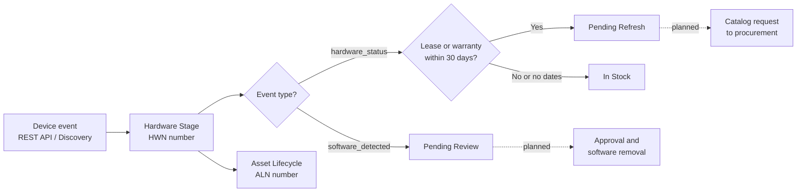

# Automated Asset Lifecycle Engine (AALE)

> Automating IT asset lifecycle decisions so hardware renewals and unapproved software are caught before they become cost or audit problems.

**Status:** 🚧 In progress. Event ingestion, lifecycle automation and tracking numbers work end to end. MID Server and Discovery are set up and verified. The ITSM workflow layer (requests and approvals) is next.

---

## 🎯 The Business Problem

Organizations track what they *own and pay for* (ITAM) separately from what is *actually running* on the network (ITOM). When these stay disconnected:

- Hardware runs past its lease or warranty and nobody notices until it fails or costs extra
- Unapproved or unrecorded software goes unreviewed
- Audits turn into manual spreadsheet reconciliation

## 💡 Business Impact

- **Avoid surprise costs:** assets nearing lease or warranty expiry are flagged early
- **Reduce audit and compliance risk:** unrecorded software is surfaced for review
- **Save manual effort:** lifecycle states are set automatically, with a trackable ID on every event and asset

## 👥 Stakeholders

| Role | What they need |
|---|---|
| IT Asset Manager | A reliable view of every asset's lifecycle state |
| Procurement | Early notice of renewals and refreshes |
| Security / Compliance | Visibility into unreviewed software |
| Service Desk | Traceable records they can reference by number |

See [USER_STORIES.md](USER_STORIES.md) for the detailed requirements.

---

## 🔄 The Process



**Business rules**

| Condition | Resulting state |
|---|---|
| Hardware event, lease or warranty expires within 30 days (empty dates ignored) | **Pending Refresh** |
| Hardware event, dates not expiring soon or empty | **In Stock** |
| Software-detected event | **Pending Review** |

**Assumptions:** lease and warranty dates come from a procurement or ITAM source (Discovery cannot see them), so they are supplied through the REST API today. The 30-day window is a configurable business rule, not a fixed standard.

---

## 📏 How Success Would Be Measured

Targets would be agreed with stakeholders. Candidate measures:

- Share of assets with a known lifecycle state
- Number of expiring assets flagged *before* expiry
- Time from detection to a refresh request or review decision
- Software items reviewed vs. left unreviewed

---

## ✅ What's Built

| Component | Details |
|---|---|
| **Scripted REST API** | `POST /api/x_1839598_automa_0/aale_inbound_events/events` validates `hostname` and `event_type`, then writes the event to Hardware Stage. Returns **201** with the new record's `sys_id`, or **400** on bad input. |
| **Hardware Stage table** | Staging table for inbound events. Each row gets a **Hardware Number** (`HWN0001001`, ...). |
| **Asset Lifecycle table** | The managed record of each asset and its state. Each row gets an **Asset Lifecycle Number** (`ALN0001001`, ...). |
| **Auto-numbering** | Number Maintenance counters plus a read-only number field on each table, for traceability like Incident numbers. |
| **Flow Designer flow** | "Process Inbound Hardware Data" creates an Asset Lifecycle record and sets its state when a Hardware Stage record is created. |
| **Business Rule** | Defaults Lifecycle State to *In Stock* if it is ever empty. |
| **MID Server + Discovery** | MID Server validated; Discovery scanned a Windows host into the CMDB (hardware, OS, installed software). |
| **Seed script** | `seed/seed_hardware_stage.js` creates sample events for testing and demos (safe to re-run). |

### Sample payload

```json
{
  "hostname": "DEMO-LT-0001",
  "event_type": "hardware_status",
  "ci_class": "cmdb_ci_computer",
  "serial_number": "SN-DEMO-LT-0001",
  "lease_expiration": "2026-12-01"
}
```

Use a lease date within 30 days of today. Expected response: **201 Created**. The asset appears in Asset Lifecycles as **Pending Refresh**.

### Try it

1. Import the app from this repository into a ServiceNow developer instance.
2. Run `seed/seed_hardware_stage.js` in **Scripts - Background** (scope: the AALE app).
3. Or send your own event with the sample payload (REST API Explorer works).
4. Open **Asset Lifecycles** to see states set automatically.

---

## 🏁 Milestones

- [x] Scoped app, staging table and lifecycle table
- [x] Scripted REST API ingestion with validation
- [x] Flow-based lifecycle rules
- [x] Auto-numbering for traceability (HWN / ALN)
- [x] MID Server + Discovery verified on a real host
- [ ] ITSM layer: catalog request and approval workflow
- [ ] Discovery results feeding Hardware Stage
- [ ] Demo video

## 🗺️ Roadmap

**Up next**
- **ITSM layer:** auto-create a Service Catalog request for *Pending Refresh* assets, and an approval and software-removal workflow for *Pending Review* assets
- **Discovery to AALE:** feed Discovery hardware and software results into Hardware Stage (today events are simulated through the REST API)

**Further out**
- Identification & Reconciliation (IRE) for duplicate-safe CI handling
- Reference fields linking lifecycle records to CMDB CIs
- Scheduled sweep and notifications for expiring assets
- Database-level uniqueness on the tracking numbers

---

## 🛠️ Technical Highlights

Scoped application architecture · Scripted REST API with validation and proper HTTP status codes · Flow Designer date-based branching · Staging-table pattern separating raw inbound data from managed records · Auto-numbered records for traceability · MID Server and Discovery verified against a real host
